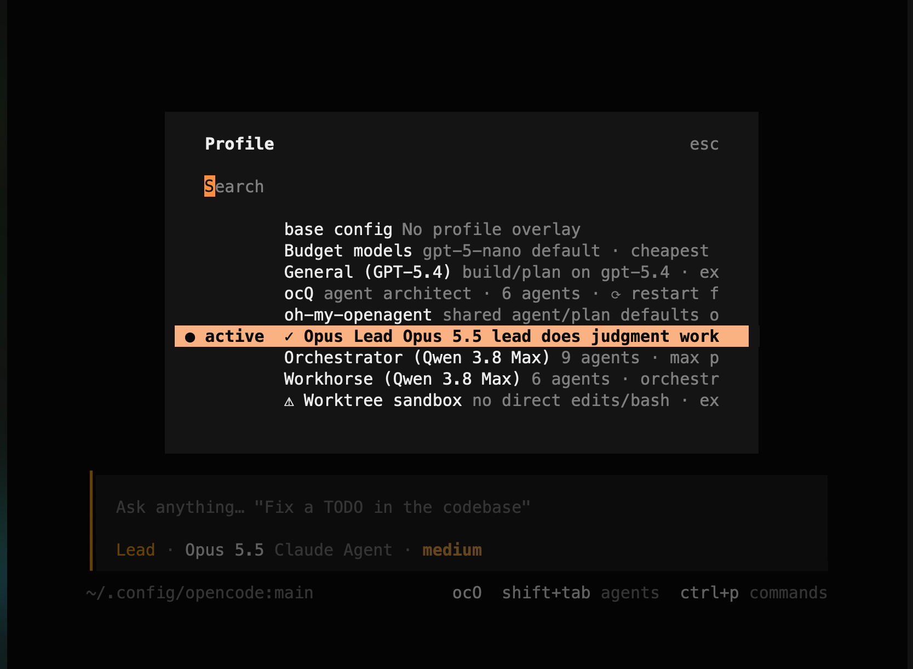
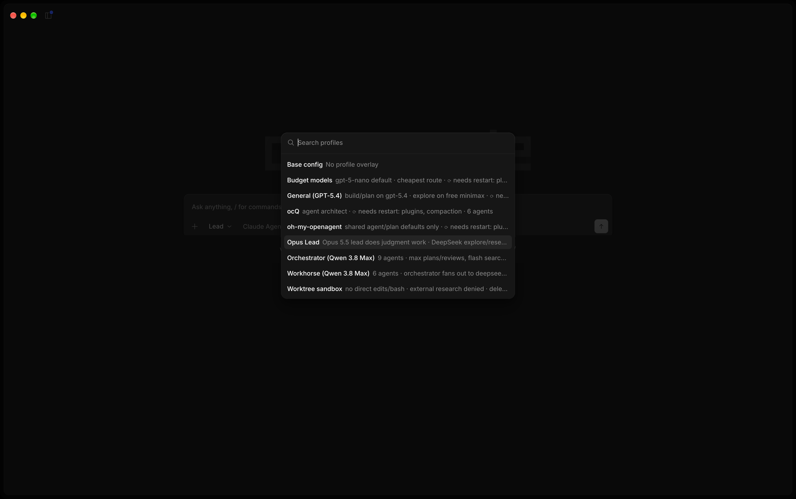

# opencode-profile-switcher

**Flip OpenCode between whole setups — models, agents, permissions, MCP servers — without editing config or restarting by hand.**

You keep one folder per setup: a cheap-and-fast one, a research one with its own
agents, a locked-down one for production repos. Then you press one key and the
whole thing changes.



That is the terminal picker: `<leader>p`, or `/profile`, or the command palette.
The footer keeps the active profile in view, with `⟳` when it still needs a
restart and `✓` once it is fully loaded.

The desktop app shows the same list, from the same server:



Titlebar pill, project menu, command palette, and Settings › Profiles — all in
sync with the terminal, because the server is the only thing holding the state.

OpenCode **2.3.0+**. MIT. No config is ever rewritten; the plugin keeps its own
little handoff file and nothing else.

## Install

Clone this repo somewhere permanent, then point `plugins` at the checkout:

```jsonc title="~/.config/opencode/opencode.jsonc"
{
  "plugins": ["/absolute/path/to/opencode-profile-switcher"]
}
```

```sh
opencode service restart
```

One entry loads every part — server, terminal UI, desktop UI. Check it landed:

```sh
opencode plugin list     # profile-switcher, source: your path
opencode plugin check    # server and TUI rows side by side
```

> **Why not `opencode plugin add`?** On 2.3.0 it takes npm and Git specs only,
> and the Git path is broken (`Unrecognized flag: --force in command opencode`).
> An absolute path needs no installer, and it hot-reloads while you edit.

If the desktop app does not show the pill yet, relaunch it once so its main
process re-reads the plugin list.

## Make a profile

A profile is a folder with an `opencode.jsonc` in it:

```text
~/.config/opencode/profiles/
└── deep/
    ├── opencode.jsonc        ← the overlay
    ├── profile.jsonc         ← optional label + description for the picker
    ├── prompts/              ← optional, pulled in with {file:…}
    │   └── architect.md
    └── agents/               ← optional markdown agents
        └── explorer.md
```

```jsonc title="~/.config/opencode/profiles/deep/opencode.jsonc"
{
  "$schema": "https://opencode.ai/config.json",
  "default_agent": "architect",
  "model": "anthropic/claude-opus-4-7",
  "agents": {
    "architect": { "model": "anthropic/claude-opus-4-7", "system": "{file:./prompts/architect.md}" },
    "explorer": { "model": "anthropic/claude-haiku-4-5", "mode": "subagent" },
    "build": { "disabled": true },
  },
  "permissions": [
    { "action": "edit", "resource": "**", "effect": "deny" },
    { "action": "shell", "resource": "git push *", "effect": "ask" },
  ],
  "mcp": {
    "servers": { "docs": { "type": "remote", "url": "https://mcp.example.com" } },
  },
  "references": {
    "handbook": { "path": "../shared/docs", "description": "Product behaviour" },
  },
  "websearch": { "provider": "random" },
}
```

Agents work both ways, and both are read live: `agents` keys in the config (the
only way to carry a prompt without a file, via `{file:}`), or markdown under
`agent/`, `agents/`, `mode/` or `modes/` — nested folders become `team/reviewer`,
and `mode/` files are always primary. A config entry wins per field, so the
prompt can live in a file while the config overrides just its model.

`model` also takes the object form
`{ "providerID": "anthropic", "model": "claude-opus-4-7", "variant": "high" }`,
and so does `agents.<name>.model`.

`profile.jsonc` is cosmetic — drop it and the picker derives a summary from
`default_agent` and `model`:

```jsonc
{ "label": "deep", "description": "architect + explorer, edits denied" }
```

Three worth starting with:

| Name it | Shape |
| --- | --- |
| `fast` | cheap default model, no per-agent overrides, research tools denied |
| `deep` | frontier model, your own agents, `build` disabled so it plans first |
| `review` | `edit` and `shell` denied, read-only docs MCP on |

## Use

### Terminal

| How | What |
| --- | --- |
| `<leader>p` | The picker (`ctrl+x` then `p` by default) |
| `/profile` | The picker, too |
| `/profile <name>` | Apply one — matches name or label, case-insensitive |
| `/profile none` | Back to base config |
| `/profile prev` | Back to the one before |
| `/profile list` | The text report: active profile, every profile, what was ignored |
| `/profile restart` | Print the exact restart command |
| `/profile policy ask\|always\|never` | Set the shared restart policy |
| Palette | "Switch profile", "Restart service with profile", "Profile restart policy: …" |

### Desktop app

| Where | What |
| --- | --- |
| Titlebar pill | Active profile; `⟳` when startup keys are pending. Click to pick. |
| Project menu | **Profile** submenu with every profile and **Base config** |
| Command palette | **Switch profile** (`mod+alt+p`) |
| Settings › Profiles | Profile select, restart policy, **Restart**, profiles folder |

## What changes when

Most of a profile applies the moment you pick it:

| Profile key | How |
| --- | --- |
| `agents` and `agent(s)/mode(s)/**.md` | created or updated live, every field: prompt, `mode`, `model`, `color`, `steps`, `hidden`, `permissions`, `request` |
| `default_agent`, `model` | the session moves to the new agent and model |
| `mcp.servers`, `references`, `websearch` | re-registered live |
| `permissions` | evaluated on every tool call, last match wins |
| agent `temperature`, `reasoningEffort`, `textVerbosity` | applied on the next request |

Agents a profile retires are **hidden, never removed** — a session still bound to
one would otherwise die on its next turn. Visibility is derived fresh on every
switch, so dropping a profile brings the originals back exactly as configured.

### About twenty keys need a restart

`plugins`, `providers`, `compaction`, `lsp`, `formatter`, `skills`, `commands`,
`experimental`, `snapshots`, `worktree`, `shell` and friends are read once when
the server starts. No plugin can change them in a running process.

So this one restarts the service *with the profile layered in* — the server reads
one extra config document from `OPENCODE_CONFIG`, merged above your global
config. That makes a profile a real config layer, not a partial overlay.

- Profiles with such keys show **`⟳ needs restart`**; after the restart they show
  **`✓ startup loaded`**.
- By default it restarts on every switch, and **never on top of a running turn**:
  the TUI queues it until the session goes idle, the desktop app polls the
  server's `busy` flag and restarts from its main process.
- Sessions and history live in the database, so they survive. The app reconnects
  on its own; if your terminal does not, relaunch `opencode`.

Three policies, shared by both clients:

| Policy | Behaviour |
| --- | --- |
| **always** *(default)* | every switch bounces the service with the new profile layered in — and switching back to base bounces it **without** the layer, so the plugins a profile added actually go away |
| **ask** | `⟳` marker plus a confirmation dialog |
| **never** | marker and a toast with the command; you restart yourself |

Change it from the palette (**"Profile restart policy: …"**) or Settings ›
Profiles. Prefer one project permanently pinned to a profile? Symlink it:

```sh
ln -s ~/.config/opencode/profiles/deep/opencode.jsonc ~/work/repo/opencode.jsonc
```

## When something looks off

Switching never silently drops a field. `/profile list` prints what it did with
each key:

```text
**deep** — `…/profiles/deep`
- default agent: `architect`
- applied live: agents, default_agent, mcp, model, permissions, references
- ⟳ needs a restart — compaction are read when the server starts:
    OPENCODE_CONFIG="…/profiles/deep/opencode.jsonc" opencode service restart
- legacy fields (ignored by V2):
    - agent — rename to "agents"
    - permission — rename to "permissions" (array of { action, resource, effect })
```

| Symptom | Fix |
| --- | --- |
| No `<leader>p`, no "Switch profile" | the plugin is not in `plugins`; add it and `opencode service restart` |
| Listed, but no `/profile` | the server half is not loaded: `opencode api get /api/plugin` → `state: active` |
| Desktop pill missing | `features.gui` must be `true` in that same response, and the plugin enabled in Settings › Extensions |
| Picked a profile, nothing moved | it uses V1 keys (`agent:`, `permission:`) — `/profile list` names them |
| Agents have no prompt | the entry has no `system` and there is no matching markdown file |
| `⟳` stays after a restart | the service came back without the layer; under **always** the clients restore it, otherwise restart from the picker |
| `could not restart the service` | the CLI is not the running binary (a wrapper or shim): set `OPENCODE_BIN` |
| Terminal hangs after a restart | relaunch `opencode` — nothing is lost |

## Limits

- **The overlay is global.** One handoff file in the config dir, so a switch
  applies to every location the service has loaded.
- **Startup-bound keys cost a bounce.** The restart is deferred while a turn
  runs, but it does interrupt the next one.
- **The layer lives in the service's environment.** Other `opencode` commands you
  start yourself need `OPENCODE_CONFIG` too. If the desktop app starts its own
  server, the layer drops — the clients put it back on their next refresh, a few
  times, then leave the marker and the command.
- **Permissions tighten, never loosen.** The hook runs after your configured
  ruleset, and an explicit `deny` is final.
- **The desktop part is experimental** (`./gui-experimental`), so a future app
  release may move it.

## Development

```sh
bun install
bun run check    # typecheck + GUI bundle + tests
```

`dist/gui-experimental.cjs` is committed on purpose: GitHub installs do not run a
build, and the desktop app needs a prebuilt bundle. Rebuild it with any GUI
change.

Editing this checkout? `./install.sh` builds the bundle and prints the
`plugins` entry; the loop is `src/` → `bun run build` → `opencode service
restart`. Contract notes and live-server recipes are in [AGENTS.md](./AGENTS.md).

## License

MIT — see [LICENSE](./LICENSE).
